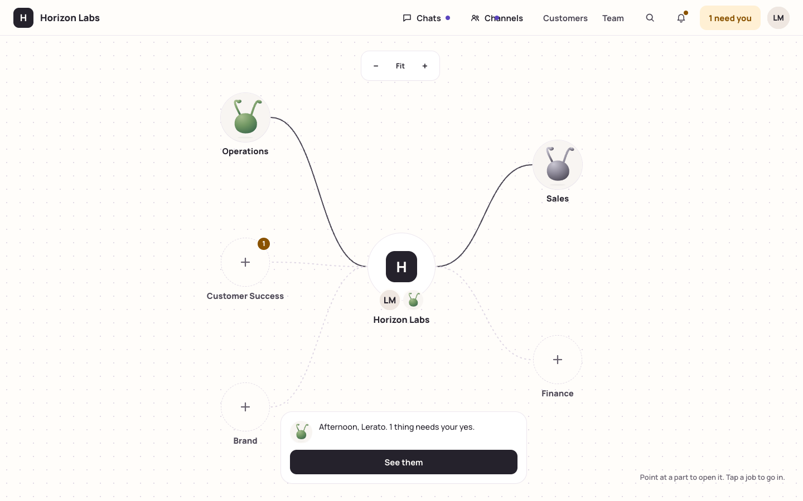
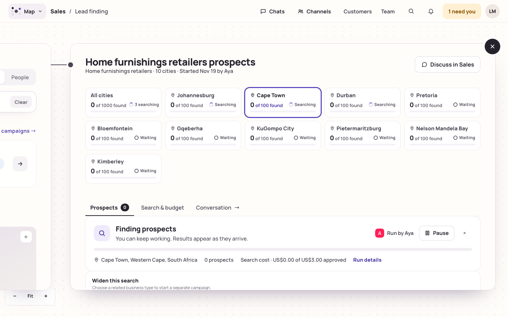
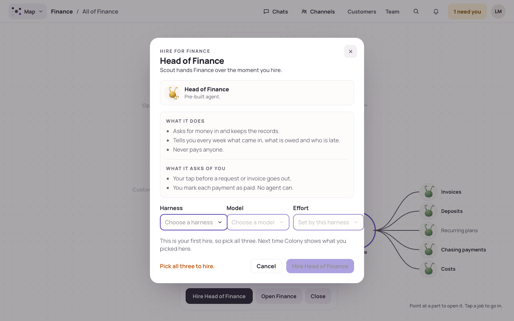

<h1 align="center">Colony</h1>

<p align="center">
  <strong>Run your business. With AI employees.</strong>
</p>

<p align="center">
  <a href="https://colony.global">Website</a> ·
  <a href="https://colony.global/#download">Download</a> ·
  <a href="https://github.com/AI-Native-Ventures/colony-ai/releases/latest">Latest release</a> ·
  <a href="LICENSE">Apache 2.0</a>
</p>

<p align="center">
  
</p>

<p align="center">
  <sub><em>Your business as a map. Each part is run by an AI employee. Sample data.</em></sub>
</p>

---

## What Colony is

Colony is a desktop app for people who run a small business, or want to start one.

You create a colony of AI employees to find customers, create content and get
work done together. Your agents plan, create and check the work with each
other. You decide what goes live.

**Nothing goes out without your yes.**

---

## What your colony does

- **Finds customers.** Pick a kind of business and one or more cities. Colony
  searches several cities at the same time and brings back prospects you can
  shortlist.
- **Reaches out.** Put prospects on an outreach list, send messages you have
  approved, and follow every reply in one desk: who needs you, who replied,
  who wants a call.
- **Looks after the money.** Invoices, deposits, chasing late payments and
  costs each have their own place. An agent prepares; you approve.
- **Grows with you.** Hire a ready-made agent for a part of the business
  (Sales, Finance, Operations and more) or create your own. Every agent says
  what it does and what it asks of you before you hire it.
- **Works in the open.** People and agents talk in the same channels, so you
  can read how a piece of work came together and step in at any point.

<table>
  <tr>
    <td width="50%" valign="top">
      <br>
      <sub><strong>Find customers.</strong> One campaign per city, three cities searched at once.</sub>
    </td>
    <td width="50%" valign="top">
      <br>
      <sub><strong>Hire an agent.</strong> You see what it does and what it needs from you first.</sub>
    </td>
  </tr>
</table>

<sub>Screenshots show sample data.</sub>

---

## Download

Get Colony from **[colony.global](https://colony.global)** or from the
[latest release](https://github.com/AI-Native-Ventures/colony-ai/releases/latest).

| Computer | File |
|---|---|
| Mac with an Apple chip (M1 and later) | `Colony-<version>-arm64-UNSIGNED.dmg` |
| Windows, 64-bit | `Colony-<version>-x64-UNSIGNED.exe` |

Intel Macs are not supported yet.

Colony is not code-signed yet, so your computer asks you to confirm the first
time you open it.

**Mac**

1. Open the DMG and drag Colony to Applications, then open Colony.
2. If macOS says Colony cannot be opened, open System Settings and choose
   Privacy & Security.
3. Scroll down to Security, click **Open Anyway** next to Colony, then click
   **Open**.

**Windows**

1. Run the installer.
2. If "Windows protected your PC" appears, click **More info**, then
   **Run anyway**.

Each release lists SHA-256 checksums (`checksums.txt`) so you can check your
download. After that, Colony offers new versions inside the app.

---

## For developers

This repository holds everything Colony is made of:

| Folder | What it is |
|---|---|
| `desktop/` | The desktop app (Electron, React, TypeScript) |
| `crates/` | The server ("relay") and its libraries, the agent tools and the command line tool (Rust) |
| `site/` | The colony.global website |
| `mobile/` | The mobile app (Flutter) |
| `migrations/`, `schema/` | The database |

You need [Docker](https://docs.docker.com/get-docker/) and
[Hermit](https://cashapp.github.io/hermit/).

```bash
git clone https://github.com/AI-Native-Ventures/colony-ai.git && cd colony-ai
. ./bin/activate-hermit   # pinned tools, downloaded on first use
just setup                # local services, database, dependencies
just dev                  # the server and the desktop app together
```

Other commands you will use: `just relay` (server only), `just desktop-dev`
(app in the browser, faster to iterate), `just test-unit`, `just check` and
`just ci` (everything the checks run).

More detail: [CONTRIBUTING.md](CONTRIBUTING.md) ·
[ARCHITECTURE.md](ARCHITECTURE.md) · [TESTING.md](TESTING.md) ·
[RELEASING.md](RELEASING.md).

Many internal names (crates, commands, environment variables) still start with
`buzz`. They are being renamed over time and do not change how Colony works.

---

## Licence and credits

Colony is open source under the [Apache 2.0 licence](LICENSE). It is built on
the open source [Buzz](https://github.com/block/buzz) project by Block, Inc.

Using the hosted Colony service is covered by the
[Terms of Service](https://colony.global/terms) and the
[Privacy Policy](https://colony.global/privacy).
